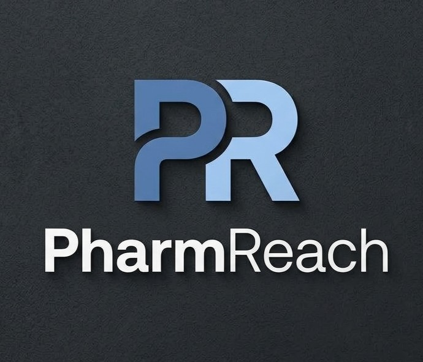

  

# PharmReach

[pharmreach.tech](https://pharmreach.tech) · [GitHub Repo](https://github.com/aidanlenahan/PharmReach)

## What it does

PharmReach allows people to search for a medicine. Then, it will show the pharmacies near them with that product available, it will show the price, the location of the pharmacy, and the time it takes to travel there for a variety of travel methods. It provides a total cost of the transportation trip along with the price of the medication itself.

## Inspiration

I, Aidan, moved to Hoboken as a student at Stevens Institute of Technology. Currently, I’m on Accutane, meaning I must pick up a script monthly. As I’m now in an area I’m unfamiliar with, getting a monthly script can be difficult to coordinate, especially since I do not have a car. Accutane causes other side effects too, meaning it wasn’t just Accutane I had to pick up. A fully-implemented website like PharmReach would make my situation extremely easier.

## How we built it

At first, we did research on a term called Pharmacy Deserts, which we learned are areas where there aren’t a lot of pharmacy locations. This makes it difficult for people without cars or those who are low-income to get access to potentially critical medication.

From there, we did market research on where these areas are, and found out that New Jersey hugely qualifies as a Pharmacy Desert in certain places due to the mismatch in human population with pharmacy population.

We then researched and compiled 6 databases of pharmacies, along with specific details about those pharmacies, and searched for the availability of certain medications for each of those pharmacies, then we input that into a map along with transportation data.

### Built With

- Gemini
- OpenStreetMap
- OpenTripPlanner
- Python
- React

## Accomplishments that we're proud of

- We are proud of the Open Trip Planner (OTP) capability, where it will find the best route based on transportation needs. It is consistent with Google and Apple Maps.
- We are also proud of the Gemini chat integration, which allows users to talk to it about their symptoms, which it will then recommend certain medications and the specific links of that medication on local pharmacy websites.
- We are also very proud of the efficient interactive map that shows pharmacy locations.

The website is very easy to use and provides a seamless user experience.

## Challenges we ran into

Getting the data for the stock of medicines/products in each pharmacy. Also the prices, it took a long time to get that data then eventually add it into the website.

## What we learned

Lack of API availability for pharmacies like CVS and Walgreens made it difficult to gather data for their stock and prices. So, we had to gather our own data looking through their websites to check the prices and stock of each of the medicines we wanted PharmReach to show in this early stage.

## What's next for PharmReach

Expanding the scope–right now it is limited to a small number of pharmacies, so adding more into our dataset would be the next step as it has limited use.
